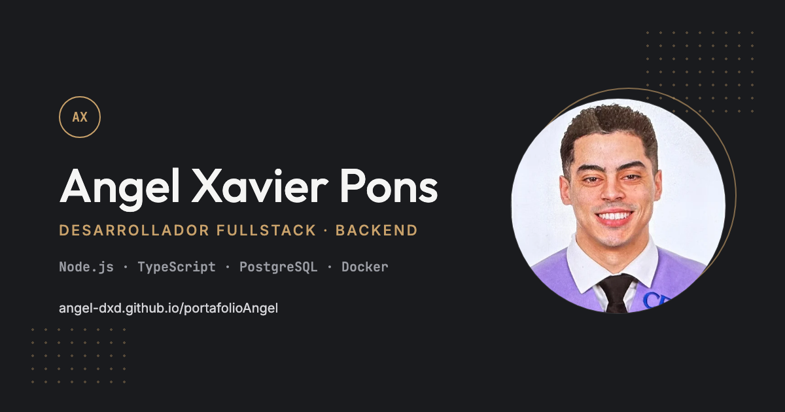

# Portafolio · Angel Xavier Pons Márquez

> Desarrollador Fullstack Junior, especializado en backend · Especialización en IA y Big Data (en curso)
> Valencia, España

🌐 **Web:** [angel-dxd.github.io/portafolioAngel](https://angel-dxd.github.io/portafolioAngel/)



---

## 📌 Sobre el proyecto

Portafolio personal estático construido con **HTML, CSS y JavaScript sin frameworks**, desplegado en GitHub Pages. Reúne mi perfil, mis proyectos, mi stack, mi experiencia y un formulario de contacto, en español e inglés.

---

## 🚀 Proyectos destacados

| Proyecto | Descripción | Stack | Enlaces |
|---|---|---|---|
| **Boutique Market** | Sistema de gestión multi-tenant en producción para dos negocios familiares, con una base de datos PostgreSQL por negocio. | Node.js · Express · PostgreSQL · JWT · Docker | [Demo](https://boutique-market.vercel.app) · [Código](https://github.com/Angel-dxd/boutique-market) |
| **DriveView** | E-commerce de gafas para conducir con configurador de receta, carrito con cupones y checkout validado. | React · TypeScript · Zustand · Zod · Playwright | [Demo](https://auronxvision.netlify.app) · [Código](https://github.com/Angel-dxd/monochrom-vision) |

---

## ✨ Características

- **Bilingüe ES / EN** con un sistema propio basado en atributos `data-i18n` y la preferencia guardada.
- **Responsive**, con menú adaptado a móvil y sin scroll horizontal.
- **Accesible**: HTML semántico, enlace para saltar al contenido, foco visible y respeto a `prefers-reduced-motion`.
- **SEO y Open Graph** con imagen propia para compartir en redes.
- **Formulario de contacto** con validación, protección anti-spam (*honeypot*) y envío mediante Web3Forms (con `mailto` como respaldo).
- **CV bilingüe** generado automáticamente con Python.
- **Sin dependencias de build**: se abre `index.html` y funciona.

---

## 📂 Estructura

```
portafolioAngel/
├── index.html        # Página principal y traducciones
├── style.css         # Estilos (tokens de color, layout y responsive)
├── favicon.svg
├── cv/
│   ├── generate_cv.py  # Generador de los CV en PDF (ES / EN)
│   ├── cv_es.pdf
│   └── cv_en.pdf
└── img/              # Foto, capturas de proyectos e imagen Open Graph
```

---

## 💻 Ejecutar en local

```bash
git clone https://github.com/Angel-dxd/portafolioAngel.git
cd portafolioAngel
python3 -m http.server 8000   # → http://localhost:8000
```

## 📄 Regenerar el CV

```bash
pip3 install reportlab pillow
python3 cv/generate_cv.py
```

---

## 📬 Contacto

- 💼 [GitHub](https://github.com/Angel-dxd) · [LinkedIn](https://www.linkedin.com/in/angel-xavier-pons-marquez/)
- 📧 angelxavierponsmarquez2018@gmail.com

---

© 2026 Angel Xavier Pons Márquez. El código del portafolio es de uso personal; las imágenes y el CV no pueden reutilizarse sin permiso.
